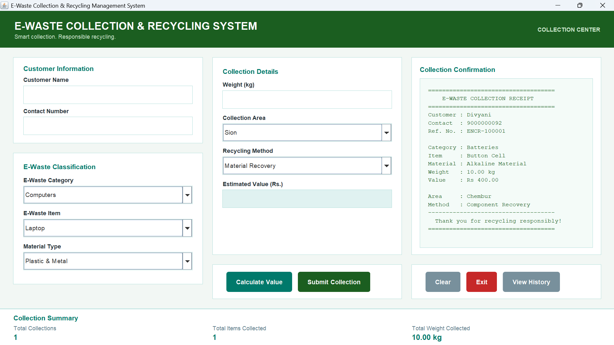
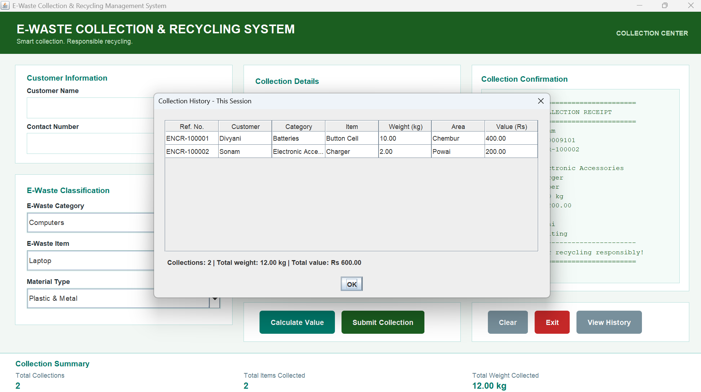

# E-Waste Collection & Recycling Management System

## 📌 Project Overview

The **E-Waste Collection & Recycling Management System** is a Java Swing-based desktop application designed to manage the collection and recycling of electronic waste. It allows users to record customer details, classify e-waste items, calculate estimated recycling values, generate collection receipts, and view collection history.

The application provides a simple and user-friendly graphical interface to promote efficient and responsible e-waste management.

## 📸 Screenshots

### Main Screen – E-Waste Collection



### Collection History



## ✨ Features

- **Customer Management:** Enter customer name and contact number.
- **E-Waste Classification:** Categorize waste into Computers, Mobile Devices, Batteries, Home Electronics, and Electronic Accessories.
- **Material Selection:** Material options update automatically based on the selected e-waste item.
- **Value Calculation:** Calculate estimated recycling value based on item weight and predefined rates per kg (Rs.).
- **Collection Details:** Select collection area and recycling method.
- **Receipt Generation:** Generate a collection receipt with a unique reference number.
- **Collection History:** View collection records in a table with total weight and total value.
- **Collection Summary:** Display total collections, total items collected, and total weight.
- **Input Validation:** Validate contact number and ensure weight is a positive number.

## 🛠️ Technologies Used

- Java
- Java Swing
- AWT
- Object-Oriented Programming (OOP)
- Java Collections Framework

## 📂 Project Structure

```text
Ewaste-Management-System/
│
├── Ewaste.java
├── README.md
├── .gitignore
│
└── Screenshots/
    ├── main-screen.png
    └── collection-history.png
```

## ⚙️ Installation & Setup

### Prerequisites

- Java Development Kit (JDK 11 or higher)
- Git
- Command Prompt or Java IDE

### Steps to Run

1. Clone the repository:

   ```bash
   git clone https://github.com/divyanipatil093/Ewaste-Management-System.git
   ```

2. Navigate to the project directory:

   ```bash
   cd Ewaste-Management-System
   ```

3. Compile the Java source file:

   ```bash
   javac Ewaste.java
   ```

4. Run the application:

   ```bash
   java Ewaste
   ```

## 🧭 How to Use

1. Enter the customer name and contact number.
2. Select the e-waste category, item, and material type.
3. Enter the weight in kg and select the collection area and recycling method.
4. Click **Calculate Value** to calculate the estimated recycling value.
5. Click **Submit Collection** to generate a receipt and update the summary.
6. Click **View History** to view current-session collection records.
7. Use **Clear** to reset the form or **Exit** to close the application.

## ⚠️ Limitations

- Collection records are stored in memory and are not permanently saved.
- Collection history is available only during the current application session.
- Recycling rates are predefined in the application.

## 🚀 Future Enhancements

- Database integration using MySQL.
- Permanent storage of customer and collection records.
- Admin login and authentication.
- Export collection receipts to PDF.
- Analytics dashboard for recycling statistics.

## 👩‍💻 Author

**Divyani Patil**

GitHub: [divyanipatil093](https://github.com/divyanipatil093)

---

⭐ If you find this project useful, consider giving it a star!
